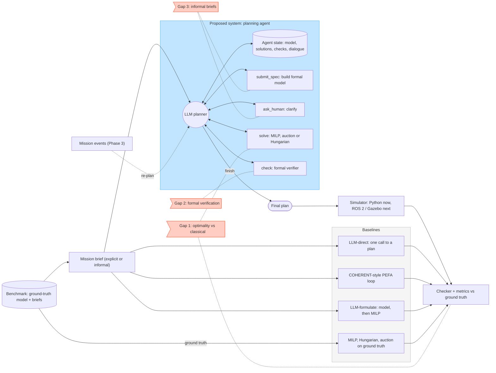
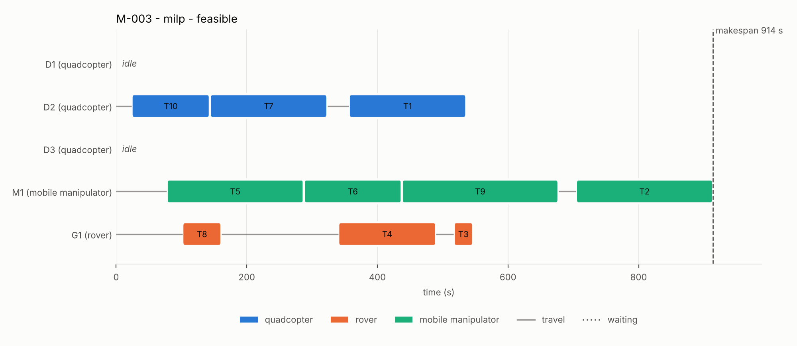

# LLM Agents for Task Allocation in Heterogeneous Multi-Robot Systems

AI4015 Agentic AI, semester project G1. Phase 1 technical foundation and baseline.

Teams of drones, ground rovers, mobile manipulators and fixed robot arms must decide
**which robot does which task, in what order**, under capabilities, payloads, travel
times, deadlines, precedence, standby rules and battery endurance. This repository
formalises that problem, generates a benchmark of scenarios with natural-language
briefs, and compares LLM-based planners against exact optimisation (MILP), the
Hungarian algorithm and auction-based allocation, with one checker deciding whether
any plan is correct.

Base paper: K. Liu et al., "COHERENT: Collaboration of Heterogeneous Multi-Robot
System with Large Language Models," ICRA 2025 ([code](https://github.com/MrKeee/COHERENT)).
Its proposal-execution-feedback-adjustment loop is reproduced here as the `llm-pefa`
baseline.

## Quick start

```bash
python -m venv .venv && source .venv/bin/activate      # Windows: .venv\Scripts\activate
pip install -r requirements.txt
python -m pytest -q                                     # 32 tests, ~5 s

python scripts/make_benchmark.py                        # 26 scenarios -> data/benchmark/ (already committed)
python scripts/run_eval.py --methods classical          # MILP, Hungarian, auction -> results/runs.csv
python scripts/summarize.py                             # -> results/summary.md
python scripts/demo.py --gantt results/demo_gantt.png   # one scenario end to end, offline (MockLLM)
```

Everything above runs without an API key. The `mock` model is a deterministic stand-in
that checks the LLM pipeline end to end; it is **not** a language model and its numbers
must not be reported as LLM results.

### Running with a real LLM

```bash
cp configs/llm.example.yaml configs/llm.yaml           # pick provider + model inside
export GEMINI_API_KEY=...                               # or OPENAI_API_KEY, GROQ_API_KEY, ...
python -m mrta.llm --config configs/llm.yaml --list-models
python -m mrta.llm --config configs/llm.yaml --ping
python scripts/run_eval.py --methods llm --llm configs/llm.yaml --tiers S --limit 3   # small first
python scripts/run_eval.py --methods llm --llm configs/llm.yaml --resume              # full sweep
python scripts/summarize.py
```

One OpenAI-compatible client covers OpenAI, Google Gemini, Groq, OpenRouter, DeepSeek and
local models through Ollama or LM Studio; switching is one line in `configs/llm.yaml`.
Replies are cached in `.cache/llm/`, `--resume` skips finished runs after a rate-limit stop,
and every LLM transcript is saved in `results/traces/` for error analysis.

## Architecture



A print-ready render of the same diagram is in [`docs/img/architecture.png`](docs/img/architecture.png).

The agent never sees the ground truth: it writes its own formal model of the brief, picks a
solver, verifies the solution against its model, and may ask a clarifying question. The
harness then checks the final plan against the ground truth, so a misread constraint still
counts as a failure. The baselines differ in what the LLM is trusted with: everything
(`llm-direct`), everything plus executability feedback (`llm-pefa`, as in COHERENT), or
only the model with no verification or recovery (`llm-formulate`).

| Module | Role |
|---|---|
| `mrta/schema.py` | Structured contracts: `Scenario`, `Robot`, `Task`, `Plan`, `Violation`, `Schedule`, `Event` |
| `mrta/geometry.py` | Travel model (air: Euclidean, ground: Manhattan, fixed: none) and eligibility |
| `mrta/schedule.py` | Timing of routes with cross-robot precedence waits and deadlock detection |
| `mrta/checker.py` | Feasibility checker, constraints C1 to C8 |
| `mrta/solvers/` | `milp.py` exact (PuLP + HiGHS), `hungarian.py` iterated assignment, `auction.py` SSI auction |
| `mrta/scenarios/` | Seeded scenario generator (feasibility guaranteed) and brief renderer (explicit, informal) |
| `mrta/llm/client.py` | Provider-agnostic chat client with caching, retries and usage accounting |
| `mrta/llm/methods.py` | `llm-direct`, `llm-pefa` (COHERENT-style), `llm-formulate` |
| `mrta/llm/agent.py` | Proposed agent: tools, state, ReAct-style JSON loop |
| `mrta/llm/mock.py` | Offline stand-in model for tests |
| `mrta/spec_eval.py` | Fidelity of an LLM-written model (fact-level F1, per-constraint recall) |
| `mrta/evaluate.py` | One run of one method on one scenario -> one results row |

## Formal model in one paragraph

Robots $r$ have capabilities, payload limits, speeds, endurance and a mobility type; tasks
$t$ have a location, required capabilities, payload, duration and an optional deadline;
precedence pairs and standby rules complete the instance. A plan is an ordered route per
robot. Robots start at $t = 0$, travel, wait for predecessors, and must be home before their
endurance ends. The objective is the makespan $C_{\max} = \max_t f_t$. This is ST-SR-TA with
cross-schedule dependencies (NP-hard). Full definitions, the MILP and every metric are in
[`docs/formal_model.md`](docs/formal_model.md).

## Benchmark

| Tier | Robots | Tasks | Scenarios | Notes |
|---|---:|---:|---:|---|
| S | 3 | 5 | 10 | MILP proves optimality in well under a second |
| M | 5 | 10 | 10 | MILP proves optimality in seconds |
| L | 8 | 16 | 6 | MILP often hits the 60 s limit; gap reported against the best known plan |

Each `data/benchmark/<id>.json` holds the ground-truth model and two briefs with the same
content: **explicit** (every requirement and unit spelled out) and **informal** (requirements
implied, times in minutes). Every scenario is guaranteed feasible, so an infeasible plan is
always the method's fault. Regenerate or enlarge with
`python scripts/make_benchmark.py --tiers S=20,M=20,L=10 --out data/bench_v2`.

## Initial results (classical baselines)

| Tier | Method | Feasible plans | Mean gap | Median gap | Mean planning time |
|---|---|---:|---:|---:|---:|
| S | MILP (HiGHS, 60 s limit) | 10/10 | 0.0% | 0.0% | 0.03 s |
| S | Iterated Hungarian | 10/10 | 15.1% | 0.0% | < 0.01 s |
| S | SSI auction | 10/10 | 9.5% | 0.0% | < 0.01 s |
| M | MILP (HiGHS, 60 s limit) | 10/10 | 0.0% | 0.0% | 0.74 s |
| M | Iterated Hungarian | 9/10 | 28.3% | 19.9% | < 0.01 s |
| M | SSI auction | 10/10 | 27.0% | 21.0% | < 0.01 s |
| L | MILP (HiGHS, 60 s limit) | 6/6 | 0.0% | 0.0% | 43.49 s |
| L | Iterated Hungarian | 5/6 | 28.9% | 27.6% | < 0.01 s |
| L | SSI auction | 6/6 | 17.8% | 20.3% | 0.01 s |

Gap = (makespan - reference) / reference over feasible plans. The reference is the MILP optimum
for 23 of 26 scenarios; for the 3 L-tier scenarios where the MILP hit its time limit it is the
best plan found by any method, so the MILP gap there is 0 by construction. Full table:
[`results/summary.md`](results/summary.md); raw rows: [`results/runs.csv`](results/runs.csv).

What these numbers already say: the myopic heuristics finish 9.5 to 29% later than the reference on
average, the iterated Hungarian method breaks a deadline in 2 of 26 scenarios, and MILP planning
time grows from milliseconds (S) to tens of seconds (L), which is where LLM-guided solver choice
and heuristic warm starts can matter.



*Optimal MILP schedule for M-003 (`python scripts/demo.py --method milp --scenario data/benchmark/M-003.json --style explicit --gantt ...`).*

LLM rows will be added once the experiments run with a real model; the pipeline itself is
already exercised end to end by `tests/test_llm_pipeline.py` and `scripts/demo.py`.

## Roadmap

| Phase | Work |
|---|---|
| 1 (now) | Formal model, checker, benchmark, three classical baselines, LLM baselines, agent skeleton, offline end-to-end run |
| 2 | LLM experiments on both brief styles; agent upgrades for the selected gaps (model self-consistency, targeted clarification, verifier-guided repair) |
| 3 | Mission events (robot failure, new task, deadline change) with re-planning; ROS 2 + Gazebo bridge executing plans; optional hardware demo |
| 4 | Ablations, statistics, paper |

## Repository layout

```
configs/            LLM provider config template
data/benchmark/     26 scenarios (JSON) + index.csv
docs/               formal model
mrta/               the package (see the module table)
results/            runs.csv, summary.md (traces/ is git-ignored)
scripts/            make_benchmark, run_eval, summarize, demo
tests/              checker, solvers, generator, LLM pipeline
```

## References

- K. Liu et al., "COHERENT: Collaboration of heterogeneous multi-robot system with large language models," ICRA 2025.
- K. Obata et al., "LiP-LLM: Integrating linear programming and dependency graph with large language models for multi-robot task planning," IEEE RA-L, vol. 10, no. 2, 2025.
- B. P. Gerkey and M. J. Matarić, "A formal analysis and taxonomy of task allocation in multi-robot systems," IJRR, 2004.
- M. G. Lagoudakis et al., "Auction-based multi-robot routing," RSS, 2005.
- H. W. Kuhn, "The Hungarian method for the assignment problem," Naval Research Logistics Quarterly, 1955.
