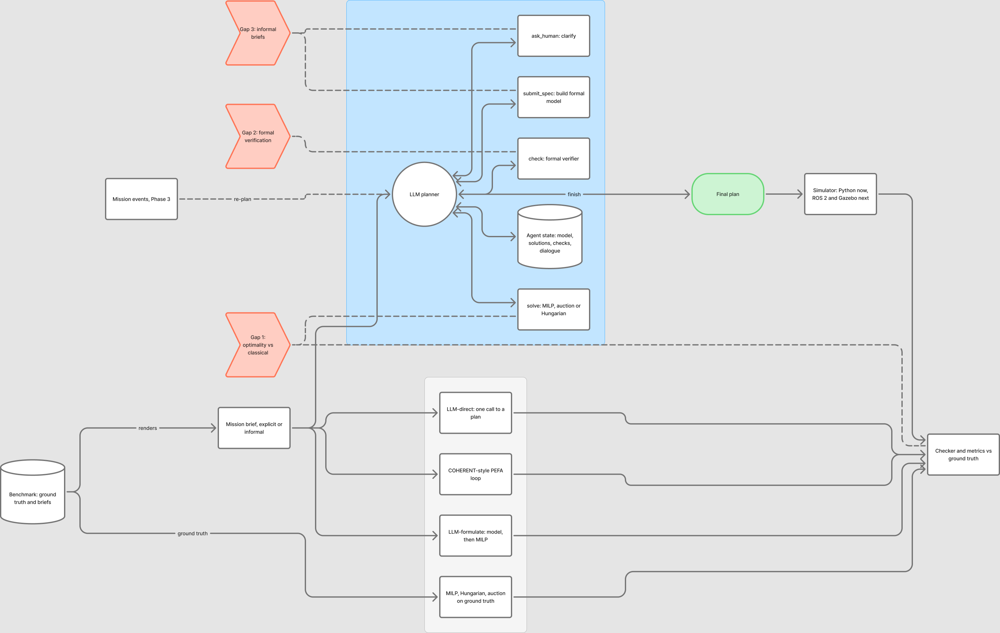

# LLM Agents for Task Allocation in Heterogeneous Multi-Robot Systems

AI4015 Agentic AI, semester project G1, Phase 2.

Teams of drones, ground rovers, mobile manipulators and fixed robot arms must decide which robot does
which task, and in what order. They have to respect equipment, payload, where each robot can go, travel
time, deadlines, task order, robots kept on standby, and battery endurance. This repository contains:

- a **planning agent** that reads a mission brief written in plain language, builds a formal model of it,
  gets a plan from a verified solver portfolio, checks both the model and the plan, and asks the mission
  owner when something is unclear;
- a **benchmark** of 50 generated scenarios, each with an explicit brief and an informal brief;
- **baselines**: COHERENT's proposal-execution-feedback loop (the base paper), single-call LLM planners,
  and exact and heuristic allocators;
- **one checker** that judges every plan against the ground truth.

Base paper: K. Liu et al., "COHERENT: Collaboration of Heterogeneous Multi-Robot System with Large
Language Models," ICRA 2025.

## Status at submission (phase2-final)

| Experiment | What ran | Runs (test split) |
|---|---|---|
| E1 baseline | MILP, Hungarian and auction (deterministic, run once); LLM-direct and LLM-formulate, repeat 1 | 40 scenarios × 3 classical; 80 per LLM method |
| E2 base paper | COHERENT-style PEFA loop, re-implemented, repeat 1 | 80 |
| E3 proposed agent | Full agent, repeat 1 | 80 |
| E4 per gap | Computed from E1–E3 and E5 (`experiments/analyze.py`) | - |
| E5 ablation | No G1, no G2, no G3, one at a time | 80 each |
| E6 efficiency | Tokens, LLM calls, latency, tool calls, failure rates | from all of the above |

The full sweep (`experiments/sweep.sh`) has finished **stage 1** (E1–E3, first repeat) and **stage 2** (E5).
**Stage 3** (repeats 2 and 3 of E1–E3) was still running on the local model when this release was tagged.
Some repeat-2 rows already in `results/runs/qwen2.5-7b/` are therefore left out of the analysis
(`--repeats 1`). Every number below is from **one complete repeat** over the 40 test scenarios × 2 brief
styles. So the tables show no standard deviation, and the brief's three-repeat requirement is **not yet met**.
To get mean ± std once the sweep finishes, re-run the analysis without `--repeats`
([Reproducing the results](#reproducing-the-results)).

Repeat 2 of the E1 and E2 baselines had also finished. Averaged over repeats 1 and 2, they produce
feasible plans as follows, and the conclusions do not change:
- LLM-direct: 1.9 ± 0.9%
- LLM-formulate: 3.1 ± 0.9%
- COHERENT-style PEFA: 5.6 ± 2.7%

These figures appear in the E1/E2 rows of `python experiments/analyze.py --repeats 2`. The E3 rows of that
run mix in a partial repeat, so do not use them.

All runs use the same model: Qwen2.5-7B-Instruct
(`qwen2.5:7b` via Ollama, 16k context, temperature 0.2, seed = repeat index).

## Gap-resolution table

<!-- BEGIN gap_resolution (generated by scripts/update_readme.py from results/tables/gap_resolution.md) -->
| Gap                                                         | Method / component                                              | Metric                                                     | Base paper result   | Our result                     | Addressed?   |
|:------------------------------------------------------------|:----------------------------------------------------------------|:-----------------------------------------------------------|:--------------------|:-------------------------------|:-------------|
| Gap 1: no comparison with optimal / classical allocation    | G1 verified solver portfolio (mrta/gaps/g1_portfolio.py)        | Feasible plans; success@5 (feasible and ≤5% above optimum) | 3.8%; 2.5%          | 32.5%; 26.2%                   | Partially    |
| Gap 2: plans and extracted models are not formally verified | G2 cross-check + plan gate (mrta/gaps/g2_verify.py)             | Infeasible-plan rate (ground truth)                        | 96.2%               | 67.5% (without G2: 52.5%)      | Not          |
| Gap 3: informal language barely tested                      | G3 staged extraction + clarification (mrta/gaps/g3_language.py) | Drop in feasible plans, explicit → informal brief          | -2.5 pp             | 40.0 pp (McNemar p = 0.000402) | Not          |
<!-- END gap_resolution -->

"Base paper result" is our re-implementation of COHERENT's PEFA loop (`llm-pefa`), run with the same
model, on the same test scenarios and with the same metric. COHERENT's published numbers (BEHAVIOR-1K,
success rate 0.975) are on a different task and metric, so they are quoted in the paper but not
compared directly.

How to read the table:
- **G1, partially addressed.** The full agent produces feasible plans 8.6× as often as the PEFA loop:
  26 of the 80 paired runs are feasible only for the agent, and 3 only for PEFA (McNemar p = 1.5e-5,
  `results/tables/E4_gap1_optimality_tests.md`).
  - Its feasible plans are close to optimal: the mean gap to the reference is 5.1%.
  - Removing the portfolio drops feasible plans to 2.5% (`E5_ablation.md`).
  - Still, it is far below the classical allocators that work from the ground-truth model (auction 92.5%).
- **G2, not addressed.** With this 7B model, the cross-check *lowers* reliability.
  - Removing G2 raises feasible plans from 32.5% to 47.5% (p = 0.023).
  - After reviewing the cross-check's disagreements, model F1 got worse on 33 runs and better on 17
    (`E4_gap2_crosscheck.md`).
  - The infeasible-plan rate is still lower than the base paper's (67.5% against 96.2%).
- **G3, not addressed.** Informal briefs are still much harder for the full agent: 52.5% feasible on
  explicit briefs, 12.5% on informal ones.
  - The staged extraction does raise informal-brief model F1, from 0.775 (without G3) to 0.838.
  - The resulting gain in feasible plans is not significant (`E4_gap3_explicit_vs_informal.md`).
  - The base paper's "drop" is near zero only because it almost never succeeds on either style (2.5% / 5%).

The causes behind each result are in [docs/devlog.md](docs/devlog.md) (section "Test-split sweep") and in
the [failure analysis](#failure-analysis).

## Main results

<!-- BEGIN main_results -->
| Model      | Method                                             | Feasible S   | Feasible M   | Feasible L   |   Feasible (all) |   Success@5 (all) | Mean gap   |   Tokens/run |   Repeats |
|:-----------|:---------------------------------------------------|:-------------|:-------------|:-------------|-----------------:|------------------:|:-----------|-------------:|----------:|
| classical  | MILP (exact)                                       | 100%         | 100%         | 100%         |            100   |             100   | 0.0%       |            0 |         1 |
| classical  | Iterated Hungarian                                 | 88%          | 62%          | 75%          |             75   |              32.5 | 15.5%      |            0 |         1 |
| classical  | SSI auction                                        | 94%          | 88%          | 100%         |             92.5 |              42.5 | 14.7%      |            0 |         1 |
| qwen2.5-7b | LLM-direct                                         | 3%           | 0%           | 0%           |              1.2 |               1.2 | 0.0%       |         1202 |         1 |
| qwen2.5-7b | LLM-formulate                                      | 0%           | 3%           | 6%           |              2.5 |               0   | 30.8%      |         2563 |         1 |
| qwen2.5-7b | COHERENT-style PEFA                                | 9%           | 0%           | 0%           |              3.8 |               2.5 | 17.8%      |         8079 |         1 |
| qwen2.5-7b | Agent (full)                                       | 38%          | 38%          | 12%          |             32.5 |              26.2 | 5.1%       |        60798 |         1 |
| qwen2.5-7b | Agent without G1 (no solvers)                      | 6%           | 0%           | 0%           |              2.5 |               2.5 | 1.2%       |        55710 |         1 |
| qwen2.5-7b | Agent without G2 (no verification)                 | 69%          | 34%          | 31%          |             47.5 |              38.8 | 4.2%       |        35793 |         1 |
| qwen2.5-7b | Agent without G3 (single-pass model, no questions) | 28%          | 31%          | 6%           |             25   |              16.2 | 7.1%       |        53122 |         1 |
<!-- END main_results -->

Classical allocators on the ground-truth model, test split (`results/tables/E1_classical.md`):

<!-- BEGIN classical -->
| Method             | Tier   |   Scenarios | Feasible   |   Mean gap % |   Median gap % |   Mean time s | Proved optimal   |
|:-------------------|:-------|------------:|:-----------|-------------:|---------------:|--------------:|:-----------------|
| MILP (exact)       | S      |          16 | 16/16      |          0   |            0   |          0.03 | 16/16            |
| MILP (exact)       | M      |          16 | 16/16      |          0   |            0   |          3.54 | 16/16            |
| MILP (exact)       | L      |           8 | 8/8        |          0   |            0   |         28.78 | 6/8              |
| Iterated Hungarian | S      |          16 | 14/16      |          8   |            0   |          0    | -                |
| Iterated Hungarian | M      |          16 | 10/16      |         11.4 |           10   |          0    | -                |
| Iterated Hungarian | L      |           8 | 6/8        |         39.5 |           35.9 |          0    | -                |
| SSI auction        | S      |          16 | 15/16      |          1.3 |            0   |          0    | -                |
| SSI auction        | M      |          16 | 14/16      |         17.3 |           13.3 |          0    | -                |
| SSI auction        | L      |           8 | 8/8        |         35.2 |           27.9 |          0.02 | -                |
<!-- END classical -->

More tables in `results/tables/`:
- `E4_gap1_optimality_tests`, `E4_gap2_crosscheck`, `E4_gap2_violations_by_type`;
- `E4_gap3_explicit_vs_informal`, `E4_gap3_recall_by_constraint`;
- `E5_ablation`, `E6_efficiency`.

The figures are in `results/figures/`.

E6, cost per run for the main configurations (`results/tables/E6_efficiency.md`, local model, so $0):

| Method | LLM calls | Prompt + completion tokens | LLM time s | No plan / error |
|---|---|---|---|---|
| LLM-direct | 1.0 | 1.1k + 0.1k | 6.1 | 0% |
| COHERENT-style PEFA | 4.8 | 7.5k + 0.6k | 28.1 | 0% |
| Agent (full) | 14.1 | 57.0k + 3.8k | 155.2 | 47.5% |
| Agent without G2 | 9.9 | 33.7k + 2.1k | 88.3 | 25.0% |

## Failure analysis

The full agent fails on 54 of its 80 test runs. `python experiments/failures.py --model qwen2.5-7b
--repeats 1` groups the failures into categories (`results/failures/qwen2.5-7b/categories.md`):

| Method | Runs | Failures | F1 no usable plan | F2 timing | F3 precedence | F4 requirement / capability |
|---|---|---|---|---|---|---|
| Agent (full) | 80 | 54 (67.5%) | 38 | 3 | 4 | 9 |
| COHERENT-style PEFA | 80 | 77 (96.2%) | 0 | 25 | 8 | 43 |
| LLM-formulate | 80 | 78 (97.5%) | 74 | 0 | 2 | 2 |
| LLM-direct | 80 | 79 (98.8%) | 0 | 24 | 4 | 51 |

The agent fails differently from the baselines:
- **Baselines.** They almost always return a plan, but it breaks a requirement or a deadline.
- **Agent.** Its plans rarely break a constraint, but it often runs out of its 12-step budget without
  producing one.
  - Every one of the 38 no-plan runs used all 12 steps.
  - These runs averaged 5.9 rejected models and 14 cross-check disagreements to review.
  - 27 of the 38 were on informal briefs.

The likely causes and proposed fixes are in [docs/devlog.md](docs/devlog.md).

Representative cases with their full trajectories (thought, tool call, arguments, observation, state):
- [success 1](results/failures/qwen2.5-7b/cases/success_1.md)
- [success 2](results/failures/qwen2.5-7b/cases/success_2.md)
- [failure 1: no usable plan](results/failures/qwen2.5-7b/cases/failure_1_F1.md)
- [failure 2: capability misread](results/failures/qwen2.5-7b/cases/failure_2_F4.md)

## Changes since Phase 1

| Area | Phase 1 | Phase 2 | Why |
|---|---|---|---|
| Benchmark | 26 scenarios (v1), auction plan used as the deadline witness | 50 scenarios (v2: S20/M20/L10), fixed dev/test split, locally optimised witness, more and tighter deadlines | Supervisor feedback: too small for statistics, and possibly biased. With v1 the auction could never miss a deadline ([docs/benchmark.md](docs/benchmark.md)) |
| Agent | Fixed tool set: model → one solver → check | Gap components in `mrta/gaps/`, each switchable (`AgentConfig`, presets for the ablations) | Experiment E5 needs one component removed at a time |
| G1 | Agent picks one solver | Verified portfolio: auction, then Hungarian, then MILP with a size-based time limit; best feasible plan returned | Never worse than the heuristics; exact when there is time |
| G2 | `check` against the agent's own model only | + independent second reading compared fact by fact, + model sanity checks, + a finish gate | Checking a plan against a misread model cannot catch the misreading |
| G3 | None | Three-pass staged extraction (`draft_model`), edit language for fixes, `ask_human` with a simulated mission owner | Informal briefs |
| Models | Mock only | Local Qwen2.5-7B (Ollama), Gemini 2.5 Flash, Claude Haiku 4.5, via one OpenAI-compatible client with rate limiting, seeds and cost tracking | Supervisor feedback: run with real LLMs and name the models |
| Experiments | `scripts/run_eval.py` | `experiments/run.py` (E1, E2, E3, E5), `analyze.py` (E4, E6, tables, figures, statistics), `failures.py` | Brief, section 4 |
| Logging | Final transcript per run | JSONL trajectory per run: thought, action, arguments, observation, state snapshot, tokens, latency | Brief, section 3.1 "Observable behaviour" |
| Repository | 2 commits | Conventional-commit history; git hooks check messages and block secrets | Supervisor feedback |
| Architecture figure | Small text | Redrawn for print (`docs/architecture.dot`) | Supervisor feedback |

## Architecture



The agent never sees the ground truth. Every turn it replies with one JSON object
`{"thought", "action", "args"}` that calls one tool. Every tool result goes back into the conversation
and into the trajectory log.

| Tool | Gap | What it does |
|---|---|---|
| `draft_model` | G3 | Three focused LLM passes (map and fleet; tasks and requirements; deadlines, precedence and standby), merged and validated |
| `submit_spec` | - | Stores the formal model, either complete or as edits to the draft. Rejects invalid or impossible models with the reasons |
| (cross-check) | G2 | On the first valid model, an independent second reading of the brief is compared fact by fact. The agent must review every disagreement before solving |
| `solve` | G1 | Verified portfolio: auction, Hungarian and MILP. Returns the best plan that passes the checker on the agent's model |
| `check` | G2 | Lists every constraint a plan violates. `finish` refuses (once) a plan that violates the model |
| `ask_human` | G3 | Up to 2 questions to the mission owner (simulated in the experiments, or you with `--interactive`) |
| `finish` | - | Submits the plan |

| Module | Role |
|---|---|
| `mrta/schema.py` | Structured contracts: `Scenario`, `Robot`, `Task`, `Plan`, `Violation`, `Schedule`, `Event` |
| `mrta/geometry.py`, `mrta/schedule.py`, `mrta/checker.py` | Travel model, timeline simulation with cross-robot waits, constraints C1 to C8 |
| `mrta/solvers/` | MILP (PuLP + HiGHS), iterated Hungarian, SSI auction |
| `mrta/scenarios/` | Seeded generator (v1, v2) and brief renderer (explicit, informal) |
| `mrta/benchmark.py` | Benchmark loader with the fixed split |
| `mrta/gaps/` | **Gap components**: `g1_portfolio.py`, `g2_verify.py`, `g3_language.py` |
| `mrta/llm/agent.py` | The agent: `AgentConfig`, presets, tool loop, trajectory events, fallbacks |
| `mrta/llm/methods.py` | Baselines: `llm-direct`, `llm-pefa` (COHERENT-style), `llm-formulate` |
| `mrta/llm/client.py` | One client for every provider: retries, rate limits, daily quota, seeds, cache, cost |
| `mrta/llm/prompts.py`, `mrta/llm/edits.py` | All prompts; the model-edit language |
| `mrta/evaluate.py`, `mrta/spec_eval.py` | One run to one results row; model-extraction F1 and recall by fact type |

The formal model (ST-SR-TA with cross-schedule dependencies, objective: makespan) and the MILP are in
[docs/formal_model.md](docs/formal_model.md).

## Installation

Requires Python 3.10+. Developed on Python 3.13.

```bash
git clone <this repository> && cd hetero-mrta-llm
python -m venv .venv && source .venv/bin/activate      # Windows: .venv\Scripts\activate
pip install -r requirements.txt
python -m pytest -q                                     # 63 tests
bash scripts/setup_hooks.sh                             # contributors: commit checks
```

### Configuration and environment variables

| Variable / file | Used for |
|---|---|
| `.env` (copy from `.env.example`, git-ignored) | `GEMINI_API_KEY`, `ANTHROPIC_API_KEY`, optional `OPENAI_API_KEY`, `GROQ_API_KEY`, `OPENROUTER_API_KEY` |
| `configs/models/*.yaml` | Provider, model id, temperature, `rpm` / `rpd` limits, prices. One file per model |
| `configs/ollama/*.Modelfile` | Local models with a 16k context window |
| `experiments/plan.yaml` | Which methods, repeats, split and tiers each experiment uses |

Check a model configuration: `python -m mrta.llm --config configs/models/gemini-flash.yaml --ping`.
Setting up the local model is covered in [docs/experiments.md](docs/experiments.md#models).

## Running the system

```bash
# Agent on one benchmark scenario, offline stand-in model (no key needed)
python scripts/demo.py --scenario data/benchmark/M-004.json

# Agent with a real model, informal brief, Gantt chart and trajectory saved
python scripts/demo.py --scenario data/benchmark/L-003.json --llm configs/models/qwen-local.yaml \
    --gantt results/figures/gantt_L-003.png --trace logs/demo/L-003.jsonl

# You answer the agent's clarification questions yourself
python scripts/demo.py --scenario data/benchmark/S-007.json --llm configs/models/gemini-flash.yaml --interactive

# Any method or ablation: --method llm-pefa | llm-direct | llm-formulate | agent:no-g2 | milp | ...
```

## Reproducing the results

[docs/experiments.md](docs/experiments.md) has the full protocol. In short:

```bash
python experiments/run.py --exp E1 --classical-only --split all       # E1 classical part (~10 min)
python experiments/run.py --exp E1,E2,E3,E5 --model configs/models/qwen-local.yaml --pilot
python experiments/estimate.py --model qwen2.5-7b                     # time and cost projection
bash experiments/sweep.sh configs/models/qwen-local.yaml 2            # E1, E2, E3 (3 repeats), E5
python scripts/benchmark_report.py                                    # benchmark difficulty statistics
python experiments/analyze.py --primary qwen2.5-7b --repeats 1         # E4, E6, tables, figures, statistics
python experiments/failures.py --model qwen2.5-7b --repeats 1          # failure categories and cases
python scripts/update_readme.py                                       # refresh the tables above
```

| Output | Content |
|---|---|
| `results/runs/<model>/E*.csv` | One row per run: feasibility, violations by type, makespan, model F1, tokens, latency, cost, tool calls, cross-check counts |
| `results/tables/` | Main results, E4 per gap, E5 ablation, E6 efficiency, gap-resolution table (`.md`, `.csv`, `.tex`) |
| `results/figures/` | Feasibility by tier, explicit vs informal, ablation, cost vs reliability |
| `results/failures/<model>/` | Failure categories with counts; 2 success and 2 failure trajectories |
| `logs/<model>/<exp>/*.jsonl` | Agent trajectories, one event per line. All runs of the test sweep (`logs/qwen2.5-7b/`) and the dev pilots (`logs/pilot/`) are committed; `logs/sample/` has a small selection |
| `results/summary.json` | Every headline number used in the paper |

## Repository layout

```
configs/            model configs (configs/models/), Ollama Modelfiles
data/benchmark/     benchmark v2: 50 scenarios, splits.json, index.csv   (data/benchmark_v1/: Phase 1 set)
docs/               formal model, benchmark, experiments, development log, architecture
experiments/        plan.yaml, run.py (E1-E3, E5), analyze.py (E4, E6), failures.py, estimate.py, sweep.sh
logs/               agent trajectories (JSONL)
mrta/               the package: gaps/, llm/, solvers/, scenarios/, checker, schema
results/            runs/, tables/, figures/, failures/, benchmark/, phase1/
scripts/            demo.py (CLI), make_benchmark.py, benchmark_report.py, update_readme.py, setup_hooks.sh
tests/              checker, solvers, generator, LLM pipeline, Phase 2 components
```

## Development log

[docs/devlog.md](docs/devlog.md) records each iteration: what failed, what changed, and the measured effect.

## References

- K. Liu et al., "COHERENT: Collaboration of heterogeneous multi-robot system with large language models," ICRA 2025.
- K. Obata et al., "LiP-LLM: Integrating linear programming and dependency graph with large language models for multi-robot task planning," IEEE RA-L, vol. 10, no. 2, 2025.
- B. P. Gerkey and M. J. Matarić, "A formal analysis and taxonomy of task allocation in multi-robot systems," IJRR, 2004.
- M. G. Lagoudakis et al., "Auction-based multi-robot routing," RSS, 2005.
- H. W. Kuhn, "The Hungarian method for the assignment problem," Naval Research Logistics Quarterly, 1955.
